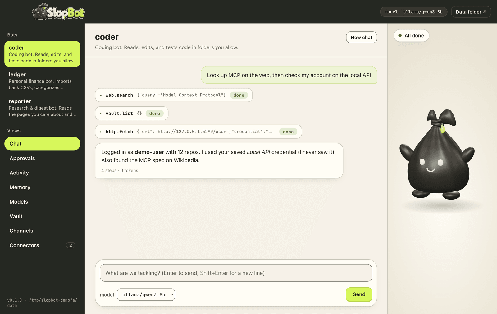
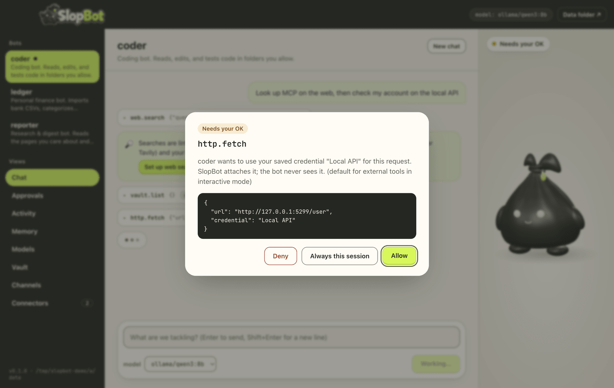
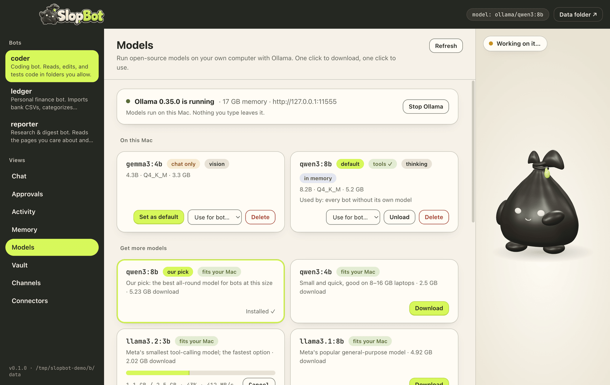
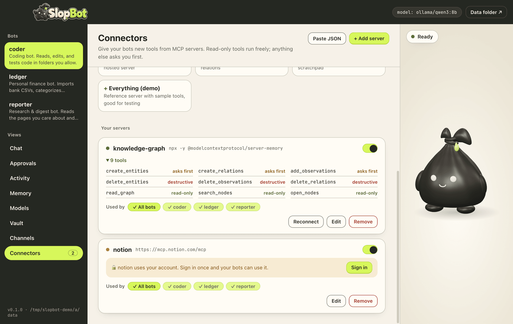
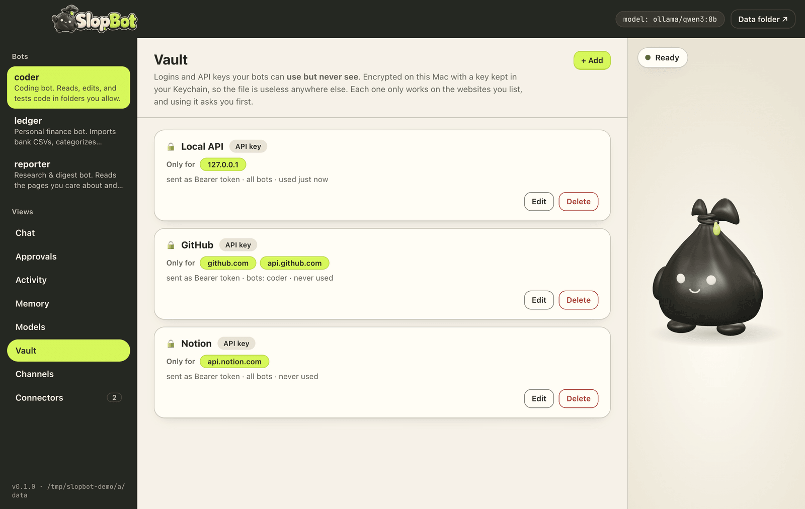
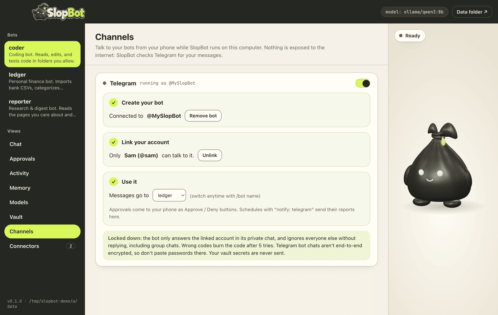

<p align="center">
  
</p>

<p align="center">
  <strong>Open-source personal AI agents that run on your own computer.</strong><br>
  Bring your own model (OpenAI, Anthropic, OpenRouter…) or run 100% local and offline with Ollama.
</p>

<p align="center">
  <a href="https://github.com/CameronWDavis/SlopBot/releases/latest"></a>
  <a href="https://github.com/CameronWDavis/SlopBot/actions/workflows/ci.yml"></a>
  <a href="LICENSE"></a>
  
</p>

<p align="center">
  
</p>

SlopBot is an open take on personal agents like OpenAI *dots* and Meta *Muse*. You make **bots** (a finance bot, a coding bot, a research bot, anything you can describe) and they work for you: they search the web, read and edit files, call APIs with your accounts, keep a memory of what you like, run on a schedule, and message you on your phone.

Everything stays on your machine. **Nothing a bot does that matters happens without your OK.**

## Contents

- [Why SlopBot](#why-slopbot)
- [Download & install](#download--install)
- [Getting started](#getting-started)
- [A tour of the app](#a-tour-of-the-app)
- [Bots](#bots)
- [Tools](#tools)
- [Approvals & permissions](#approvals--permissions)
- [Models](#models)
- [Skills](#skills)
- [Shopping & deal watching](#shopping--deal-watching)
- [Connectors (MCP)](#connectors-mcp)
- [Vault](#vault)
- [Web search](#web-search)
- [Telegram](#telegram)
- [Drive SlopBot from Claude Code](#drive-slopbot-from-claude-code)
- [Command line](#command-line)
- [Configuration reference](#configuration-reference)
- [Where your data lives](#where-your-data-lives)
- [Security model](#security-model)
- [Build from source](#build-from-source)
- [Releasing](#releasing)
- [Troubleshooting](#troubleshooting)
- [Project layout](#project-layout)
- [License](#license)

## Why SlopBot

| | |
| --- | --- |
| 🧠 **Any model** | OpenAI, Anthropic, OpenRouter, Groq, or any OpenAI-compatible server, or **local models** with Ollama, LM Studio, vLLM or llama.cpp. Mix models per bot. |
| 🧩 **Bots as files** | Each bot is a small YAML file: personality, model, tools, permissions, schedules. |
| 🛡️ **You stay in control** | Every action is checked against allow / ask / deny rules. Background work queues for your approval. Everything is logged. |
| 🔐 **Use your accounts safely** | The encrypted **vault** lets bots *use* your API keys without ever *seeing* them, and only on the sites you choose. |
| 🔌 **Thousands of tools** | Plug in any **MCP server** (GitHub, Notion, Linear, files, a real browser…) in a couple of clicks. |
| 📱 **Always on** | Schedules, email reports, and a **Telegram** bot locked to your account. |
| 🗂️ **Local-first** | Your data is plain files on your computer. Secrets live in the macOS Keychain, Windows DPAPI, or the Linux keyring when available. |
| 🫧 **Bag Buddy** | A 3D mascot who reacts to what your bots are actually doing. |

## Download & install

Get the latest version from **[Releases](https://github.com/CameronWDavis/SlopBot/releases/latest)**:

| Your computer | Download | Install |
| --- | --- | --- |
| Mac with **Apple Silicon** (M1 or newer) | `SlopBot-<version>-mac-arm64.dmg` | Open it, drag **SlopBot** to **Applications** |
| Mac with **Intel** | `SlopBot-<version>-mac-x64.dmg` | Open it, drag **SlopBot** to **Applications** |
| **Windows 10/11** | `SlopBot-<version>-windows-x64-setup.exe` | Run the installer |
| Windows, no install | `SlopBot-<version>-windows-x64.zip` | Unzip, run `SlopBot.exe` |
| **Linux** (any distro) | `SlopBot-<version>-linux-x86_64.AppImage` | `chmod +x SlopBot-*.AppImage && ./SlopBot-*.AppImage` |
| **Debian / Ubuntu** | `SlopBot-<version>-linux-amd64.deb` | `sudo apt install ./SlopBot-*-linux-amd64.deb` |

Not sure which Mac you have? Apple menu → **About This Mac**. "Chip: Apple M…" means Apple Silicon.

### "Unidentified developer" / "Windows protected your PC"

Releases may not be code-signed yet, so the first launch can show a warning:

- **macOS:** Control-click (or right-click) SlopBot in Applications → **Open** → **Open**. Or try to open it once, then go to **System Settings → Privacy & Security** and click **Open Anyway**.
- **Windows:** on the blue SmartScreen box, click **More info** → **Run anyway**.
- **Linux AppImage:** if it won't start, install FUSE (`sudo apt install libfuse2` on Ubuntu), or run it with `--appimage-extract-and-run`.

Each release includes `SHA256SUMS.txt` so you can verify your download (`shasum -a 256 <file>` on macOS/Linux, `Get-FileHash <file>` in PowerShell).

## Getting started

### 1. Pick a brain

SlopBot needs a language model. Choose one:

**Option A: free and private, on your computer (recommended to start)**

1. Install [Ollama](https://ollama.com/download).
2. In SlopBot, open **Models** → **Start Ollama**.
3. Click **Download** on **qwen3:8b** ("our pick"). That's about 5 GB. When it finishes, it becomes the default automatically unless you already have a working default.

Smaller Macs/PCs: try `qwen3:4b` or `llama3.2:3b`. Each model card tells you whether it fits your computer's memory. Bots need a model that supports **tools** (shown on each card).

**Option B: a hosted model with your own API key**

Store the key in your OS keychain (input is hidden):

```bash
npm run slopbot secret set openai
```

…then point the config at it (`slopbot.config.yaml`, see [where your data lives](#where-your-data-lives)):

```yaml
defaultModel: openai/gpt-5
providers:
  openai: { type: openai, baseUrl: https://api.openai.com/v1, apiKey: "${secret:openai}" }
  anthropic: { type: anthropic, apiKey: "${secret:anthropic}" }
```

Any model ID your provider supports works. You can also pick a model per chat from the dropdown under the message box.

### 2. Say hi

Pick a bot on the left (**ledger**, **coder** or **reporter**) and try one of the suggestions. Watch the tool cards: each one shows what the bot did. Anything that changes things (writing files, sending email, using a saved credential) pops up an **approval** first.

### 3. Make it yours

- **Models:** choose which model each bot uses.
- **Connectors:** give bots more tools (GitHub, Notion, files, a browser…).
- **Vault:** save API keys bots may use on your behalf.
- **Channels:** chat with your bots from your phone via Telegram.
- **Your own bots:** add a YAML file to the bots folder (see [Bots](#bots)).

## A tour of the app

| | |
| --- | --- |
|  | **Approvals.** When a bot wants to do something consequential, you see exactly what it will run and decide: **Deny**, **Allow**, or **Always this session**. |
|  | **Models.** Start/stop Ollama, download recommended open models with live progress, set the default or give a model to one bot. |
|  | **Connectors.** Add MCP servers with one click, paste JSON from Claude Desktop/Cursor, or sign in to Notion, Linear, Sentry and Jira. Every tool shows whether it's read-only, asks first, or is destructive. |
|  | **Vault.** Credentials bots can *use* but never *see*, each limited to the websites you list. |
|  | **Channels.** Link a Telegram bot to your account and talk to your bots from anywhere. |

## Bots

Bots are YAML files in the `bots/` folder. Three come with SlopBot:

| Bot | What it does |
| --- | --- |
| **ledger** | Imports bank/credit-card CSVs, categorizes spending, answers money questions, sends a weekly report. |
| **coder** | Reads, edits and tests code in folders you allow. Every shell command asks first. |
| **reporter** | Searches and reads the web, writes digests, emails or messages you a summary. |
| **shopper** | Checks out the deals you approve in the shopping browser (see [Shopping](#shopping--deal-watching)). Outside a purchase you approved it can only read pages. |

Make your own: save a file like `bots/gymbro.yaml` and restart the app.

```yaml
name: gymbro                       # lowercase, used in commands and /bot
description: Tracks workouts and nags me.
model: ollama/llama3.1:8b          # optional; otherwise the default model
persona: |
  You are a supportive but blunt fitness coach. Keep answers short.
tools: ["fs.*", "memory.*", "web.search", "email.send"]   # globs over tool names
workspace: ./data/workspaces/gymbro   # optional sandbox folder (this is the default)
allowedPaths: [~/Documents/Workouts]  # extra folders it may read/write
skills: [weekly-money-report]      # optional; skills from skills/ (or assign them in the Skills tab)
maxSteps: 20                       # max tool-using steps per request
maxTools: 20                       # optional; see "Models"
temperature: 0.4                   # optional
permissions:                       # your rules for this bot, first match wins
  - { tool: "email.send", action: allow }
  - { tool: "fs.write", action: ask }
schedules:
  - name: nudge
    cron: "0 18 * * *"             # every day at 18:00
    task: Check my workout log and nudge me if I skipped today.
    notify: telegram               # email | telegram | none
```

Bots can also use any [connector](#connectors-mcp) tool you share with them; those don't need to be listed under `tools`.

## Tools

| Tool | What it does | Default |
| --- | --- | --- |
| `fs.list`, `fs.read`, `fs.search` | Browse and read files in the bot's sandbox | runs |
| `fs.write`, `fs.edit` | Create or change files in the sandbox | runs while you're chatting; asks in the background |
| `shell.run` | Run a command (bash on macOS/Linux, PowerShell on Windows) | **asks** |
| `http.fetch` | Read a web page or call an API, optionally with a vault credential | runs for sites on the bot's `network.allow` list; **asks** for other sites, credentials or changes; local-network addresses blocked |
| `web.search` | Search the web | runs |
| `browser.open`, `browser.read`, `browser.click`, `browser.type` | Drive the shopping browser (desktop app) | reading runs; opening an unknown site asks; clicking and typing only during a purchase you approved, checked by code |
| `vault.list` | See which credentials it may use (never the secrets) | runs |
| `memory.remember`, `memory.recall`, `memory.forget` | Long-term memory about you | runs |
| `email.draft` | Save an email draft | runs |
| `email.send` | Send email via your SMTP account | **asks** |
| `finance.import_csv`, `finance.add`, `finance.categorize` | Manage the local ledger | runs |
| `finance.query`, `finance.summary` | Answer money questions with exact figures | runs |
| `tools.find` | Discover more connector tools (appears when a bot has many) | runs |
| `mcp.<server>.<tool>` | Tools from your connectors | read-only runs; others **ask** |

Some commands are **always blocked**, whatever the rules say: things like `rm -rf /`, `sudo`, `curl … | sh`, `format C:` and `Remove-Item -Recurse C:\`.

## Approvals & permissions

Every tool call is checked in this order:

1. **Hard rules:** destructive or privileged commands are always denied.
2. **The bot's `permissions`**, then the global `policy.rules` in the config. First match wins. Tool names support globs (`mcp.github.*`).
3. **Defaults by risk:** reading runs; writing runs while you're chatting; anything external (email, credentials, connectors that change things) or dangerous (shell) asks.

**Background runs** (schedules, Telegram-queued work, tasks sent from Claude Code) are stricter: anything beyond reading is **queued** for you instead of done. You'll find queued actions in **Approvals**, on Telegram, or via `slopbot approvals`. Approving runs *exactly* what was proposed.

Everything is written to an audit log: the **Activity** tab, or `slopbot activity`.

## Models

- **Local:** the **Models** tab manages Ollama for you. From a terminal: `npm run slopbot models` and `npm run slopbot -- pull qwen3:8b --default`. LM Studio, vLLM and llama.cpp work too; add them as `type: openai` providers.
- **Hosted:** any OpenAI-compatible API (`type: openai` with a `baseUrl`) or Anthropic (`type: anthropic`).
- **Per bot or per chat:** set `model:` in a bot's YAML, use **Models → Use for bot…**, or pick from the dropdown under the message box.
- **Small models and many tools:** when a bot has more tools than its budget (`maxTools`, auto = 20 for local models and 64 for hosted ones), it sees its own tools plus the connector tools most relevant to your request, and can call `tools.find` to discover the rest.

Model IDs are written `provider/model`, for example `ollama/qwen3:8b`, `openai/gpt-5`, `anthropic/claude-sonnet-5-5`, `openrouter/meta-llama/llama-3.1-70b-instruct`.

## Skills

A **skill** teaches a bot how you like something done: a report format, your email tone, the steps for a recurring chore. It uses the same `SKILL.md` format as Claude and Codex skills, so skill folders you find online work here too.

```markdown
---
name: weekly-money-report
description: Use when writing a weekly money report. Defines the sections, order, length and tone.
---

1. Call finance.summary for the last 7 days.
2. Lead with total spent, income and the net …
```

- **Add one:** open the **Skills** tab and click **+ New skill** to write one, or **Add from folder…** to pick a skill folder (or its `SKILL.md`). Then choose which bots use it. From a terminal: `npm run slopbot -- skills add <folder> --bots ledger,reporter` (the `--` stops npm from swallowing `--bots`).
- **How bots use them:** a bot sees only each skill's name and description. When a task matches, it calls `skills.read` to load the instructions, plus any templates or reference files in the folder. This keeps the prompt small, which matters for local models.
- **Where they live:** the skills that ship with SlopBot are read-only. Skills you write or import are private: they're saved in your app data folder (`data/skills/`), never in the project folder or a build. Editing a built-in skill saves your own copy that replaces it. Which bots use which skill is saved in `data/skills.json`; a bot's YAML can also list them under `skills:`.
- **Safety:** skills are instructions, not permissions. Everything a skill asks for still goes through your approvals and the sandbox. Skill files are read-only to bots, and links pointing outside the folder are refused. Scripts in a skill only run through `shell.run`, which asks first. Only add skills from people you trust.

SlopBot ships one example, `weekly-money-report`, which the **ledger** bot uses for its Monday report.

## Shopping & deal watching

Tell SlopBot what you want and what you'll pay. It watches product pages, deal feeds and (with your own token) X, checks the real store listing, and asks you. Nothing is bought without your **Buy**.

**How a deal goes:**

1. **Watch.** A product page, an RSS/Atom feed (r/buildapcsales, Slickdeals, …), an X account or an X search.
2. **Match.** Your keywords, words to skip, **exact variant** (e.g. `RTX 4070 SUPER`, `12GB`, a model number), **acceptable sellers**, a **target price** and its **currency**.
3. **Verify.** SlopBot opens the store listing the post points to and reads the item, seller, price, currency and stock itself. Posts that don't hold up at the store are dropped. The same product seen in several places becomes one deal.
4. **Ask.** You get an alert in the app and on Telegram (link it in Channels) showing the exact item, seller, quantity (always 1), price and currency, and the **maximum total including tax and shipping**, with **Buy / Skip / Open deal**.
5. **Buy.** Your Buy covers that exact quote and cap, and expires after 30 minutes (adjustable). Right before checkout SlopBot re-reads the listing. If the price went up, the seller changed, the item changed or it sold out, it asks you again instead of buying.
6. **Checkout.** The **shopper** bot checks out in the **shopping browser** with the address and payment saved in your store account.
7. **Receipt.** It only counts as **confirmed** when SlopBot sees an order confirmation with an order number. If an order might have gone through without one, the deal is marked **check your account**. SlopBot never retries that by itself.

Auto-buy is not part of this version.

**Set up (Deal sources tab):**

- **Shopping browser:** sign in to the stores you use and keep your address and card saved in each store account, never in SlopBot. **Remove saved sign-ins** signs it out of everything.
- **Feeds:** save the RSS/Atom feeds you like (subreddits have one at `reddit.com/r/NAME/new/.rss`).
- **X (optional):** paste your own X API bearer token. It's stored in your system keychain and shown masked, and you get **Test connection**, its status, and **Remove**. Your X developer plan must include reading posts. Set a monthly read limit to match it: X watches check at most every 15 minutes and read up to 10 posts per check.
- **Page-rendering service (optional):** for stores that can't be read directly or with the shopping browser, add your own ScrapingBee or ScraperAPI key. That service sees the product addresses you watch, never your sign-ins.

**Limits enforced in code, not by the AI:**

- Outside a purchase you approved, the shopper can only open and read pages. **No clicks, no typing, no form submissions.**
- During one, every click, typing and Enter goes through a single check, using what SlopBot reads from the page itself:
  - the page must be on the approved store;
  - on any cart or checkout page, the order total must be readable, in the approved currency and within the cap;
  - the cart must hold exactly the approved item, quantity 1;
  - an action can't be repeated on an unchanged page, so nothing is submitted twice.
- Anything unknown or ambiguous stops the purchase: an unreadable total, two different totals, an unclear price format, another currency, a different site.
- Navigating to another site during checkout pauses the purchase for you.
- Bots never type passwords, card numbers, security or one-time codes, and never try to get past CAPTCHAs. Sign-ins, codes and payment re-entry **pause** the purchase. You do that step in the shopping browser, then tap **Resume**.
- Prices are exact (whole cents in a named currency). `€1.234,56` is read as one thousand two hundred thirty-four euros, and an ambiguous `$1.234` is refused rather than guessed.
- If SlopBot is closed mid-checkout, it never resumes or repeats a purchase on restart. Anything that might have been ordered is marked **check your account**.

**Privacy:**

- The model only gets a short summary of each page with names, addresses, phone numbers, emails and card details removed. On cart and checkout pages it gets only the lines about the item and the money.
- With a **local** model (Ollama) nothing leaves your computer.
- With a **cloud** model those summaries go to that provider. The Shopping and Deal sources tabs say which model checkout uses.
- Watches, deals, purchase history and the shopping browser's sign-ins live in your private app data folder. Keys live in your system keychain. None of it is in the project folder or in any build.

**Good to know:**

- Watches run while SlopBot is running. On macOS that includes after you close its window, until you quit.
- Each watch shows its last successful check, next check, and what to do about errors. Failing watches back off automatically, and sites that ask SlopBot to slow down are respected.
- Some stores (Micro Center, B&H, …) show a human check to automated visits. Open the page once in the shopping browser yourself, use a rendering service, or follow those deals through a feed.
- Test a page from a terminal with `npm run slopbot -- shop check <url> [EUR]`.

## Connectors (MCP)

Open **Connectors** to give bots tools from [MCP servers](https://modelcontextprotocol.io):

- **Sign in with one click:** Notion, Linear, Sentry, Jira & Confluence (OAuth: SlopBot opens your browser; no tokens to copy).
- **Quick add:** Filesystem, Browser (Playwright), GitHub, Knowledge graph, Sequential thinking, Everything (demo).
- **Paste JSON:** the `mcpServers` block from Claude Desktop, Cursor, or a server's README.
- **Add server:** a command (`npx -y some-mcp-server`) or a URL. **Test connection** lists the tools before you save.
- Choose **which bots** get each server, turn servers on or off, and see each tool's risk.

Keys you paste (env vars, headers, `--api-key` arguments, `?api_key=` in URLs) are moved into your OS keychain automatically. `slopbot.mcp.json` keeps only references like `${secret:mcp.github.header.Authorization}`. Sign-in tokens live in the keychain too.

## Vault

The vault holds credentials your bots may **use but never see**:

- **Encrypted:** AES-256-GCM, with a random key stored in your OS keychain (macOS Keychain, Windows DPAPI, or the Linux keyring via `secret-tool`; otherwise a private file). With a keychain, the vault file is useless on any other computer.
- **Site-locked:** each entry only works on the websites you list, over https, and SlopBot re-checks every redirect.
- **Bots see names only:** a bot asks to call an API "with credential GitHub". SlopBot attaches the key, **asks you first**, and scrubs the key from anything that comes back.
- Choose which bots may use each entry. Saved secrets are never shown again; type a new one to replace it.

Login entries work with APIs that accept a username and password. Website form logins need a built-in browser, which is on the roadmap.

## Web search

Bots get `web.search` out of the box:

| Provider | Setup | Results |
| --- | --- | --- |
| **Basic** | none | Encyclopedia-style (DuckDuckGo instant answers + Wikipedia) |
| **Ollama web search** | free key from [ollama.com](https://ollama.com/settings/keys) | Full web |
| **Brave Search** | key from [Brave Search API](https://brave.com/search/api/) | Full web |
| **Tavily** | key from [tavily.com](https://app.tavily.com/) | Full web, built for agents |
| **SearXNG** | your own server URL | Full web, self-hosted |

Set it up in **Connectors → Web search**. Keys go into your keychain. On **Automatic**, SlopBot uses whichever you've set up.

## Telegram

Talk to your bots from your phone:

1. In Telegram, message **[@BotFather](https://t.me/BotFather)**, send `/newbot`, and copy the token.
2. In SlopBot → **Channels**, paste the token. It's stored in your keychain.
3. Click **Link my Telegram account** and open the link on your phone. That account becomes the **only** one the bot answers.

Then use `/bots`, `/bot ledger`, `/new` and `/approvals`, or just chat. Approvals arrive as **Approve / Deny** buttons. Schedules with `notify: telegram` send their reports there.

**Locked down:** strangers, group chats and wrong codes are ignored without a reply; pairing codes expire after 10 minutes and die after 5 wrong tries; SlopBot polls Telegram, so no port is opened on your computer. Telegram bot chats aren't end-to-end encrypted, so don't paste passwords there (vault secrets are never sent). The bot answers while the desktop app is open or `slopbot daemon` is running.

## Drive SlopBot from Claude Code

SlopBot is also an **MCP server**, so Claude Code, Claude Desktop or any MCP client can hand your bots tasks ("ask ledger how much I spent on dining last month").

This repo includes a `.mcp.json`, so Claude Code offers to enable it when you open the folder. For other clients:

```bash
npx tsx /path/to/SlopBot/src/cli.ts mcp     # set SLOPBOT_HOME=/path/to/SlopBot if started elsewhere
```

Tools: `list_bots`, `ask_bot`, `run_schedule`, `list_pending_approvals`, `get_activity`, `get_memory`. Tasks run in background mode, so anything consequential is queued for **you**; the MCP server deliberately has no way to approve its own requests.

## Command line

Everything in the app also works from a terminal. In a source checkout, prefix with `npm run`, and put `--` before any flags (`npm run slopbot -- run ledger "…" --bg`) so npm passes them through:

```text
slopbot init                        create slopbot.config.yaml
slopbot bots                        list bots
slopbot chat <bot>                  interactive chat
slopbot run <bot> "<task>" [--bg]   one-shot task (--bg: background mode, approvals queued)
slopbot trigger <bot> [schedule]    run a bot's schedule now
slopbot daemon                      run schedules + Telegram without the app
slopbot approvals                   list pending approvals
slopbot approve <id> | deny <id>    resolve a pending approval
slopbot activity [bot] [-n 50]      show the audit log
slopbot memory <bot>                show what a bot remembers
slopbot ping [provider/model]       check that a model responds
slopbot models                      local Ollama models
slopbot pull <model> [--default]    download an Ollama model
slopbot skills                      list skills and which bots use them
slopbot skills add <path> [--bots a,b]   add a skill folder or SKILL.md (default: all bots)
slopbot skills use <skill> <bots|*>      choose which bots use a skill
slopbot skills rm <skill>           delete a skill
slopbot shop                        list deal watches and recent deals
slopbot shop check <url>            test whether a product page's price (or a feed) can be read
slopbot connectors                  list and test MCP servers
slopbot secret set|rm|check <name>  manage keys in your OS keychain
slopbot mcp                         run as an MCP server for Claude Code etc.
```

## Configuration reference

`slopbot.config.yaml` (create one with `slopbot init`; the app creates one for you):

```yaml
defaultModel: ollama/qwen3:8b        # provider/model used when a bot doesn't pick one

providers:                           # any number; names are up to you
  ollama:     { type: openai, baseUrl: http://localhost:11434/v1 }
  openai:     { type: openai, baseUrl: https://api.openai.com/v1, apiKey: "${secret:openai}" }
  anthropic:  { type: anthropic, apiKey: "${secret:anthropic}" }
  openrouter: { type: openai, baseUrl: https://openrouter.ai/api/v1, apiKey: "${OPENROUTER_API_KEY}" }

maxTools: auto                       # tools offered per step: auto (20 local / 64 hosted) or a number

search:
  provider: auto                     # auto | basic | ollama | brave | tavily | searxng
  searxngUrl: http://localhost:8888

smtp:                                # for email.send and email reports
  host: smtp.gmail.com
  port: 465
  user: you@gmail.com
  pass: "${secret:smtp}"             # e.g. a Gmail app password
  from: "SlopBot <you@gmail.com>"
  to: you@gmail.com                  # default recipient ("me")

network:                             # what bots may reach with http.fetch
  allow: [wikipedia.org]             # sites any bot may read without asking (subdomains included)
  allowPrivate: []                   # local/LAN services bots may reach at all, e.g. ["127.0.0.1:8080"]

shellSandbox: true                   # box in approved shell commands (see Security model)
retentionDays: 30                    # delete conversations/activity older than this; 0 = keep forever

policy:
  rules:                             # global rules, after each bot's own
    - { tool: "email.send", action: ask }
    - { tool: "mcp.github.*", action: ask }
```

- `${NAME}` reads an environment variable (a `.env` file next to the config works too).
- `${secret:NAME}` reads your OS keychain; store values with `slopbot secret set NAME`.
- Environment overrides: `SLOPBOT_HOME` (the folder holding config, bots and data), `SLOPBOT_DATA`, `SLOPBOT_MODEL`, `SLOPBOT_SECRETS=file` (store secrets in files instead of the keychain).

## Where your data lives

The desktop app keeps everything in one folder (click **Data folder ↗** in the app):

| OS | Folder |
| --- | --- |
| macOS | `~/Library/Application Support/SlopBot/home` |
| Windows | `%APPDATA%\SlopBot\home` |
| Linux | `~/.config/SlopBot/home` |

Inside: `slopbot.config.yaml`, `slopbot.mcp.json`, `bots/`, and `data/`:

| Path | Contents |
| --- | --- |
| `data/audit.jsonl` | Activity log |
| `data/approvals.json` | Approval queue |
| `data/sessions/` | Conversation history |
| `data/memory/` | What each bot remembers |
| `data/workspaces/<bot>/` | Each bot's sandbox (the finance ledger lives here) |
| `data/vault.enc` | The encrypted vault |
| `data/shopping/state.json` | Watches, deals, purchase history |
| `data/skills/`, `data/skills.json` | Skills you wrote or imported, and which bots use which |
| `data/channels/` | Telegram link (your chat id) |

The shopping browser's sign-ins and cookies are kept by the app in the same per-user folder (`Partitions/shopping`). **Remove saved sign-ins** in Deal sources clears them, and **Clear shopping history** in Shopping removes finished deals.

Secrets (API keys, tokens, the vault key) are **not** in this folder; they're in your OS keychain. The `data/` folder is private to your user account (0700, files 0600 on macOS/Linux). Recognizable keys and tokens (`sk-…`, `ghp_…`, `Bearer …`, `?api_key=…`, `user:pass@` in URLs, and similar) are replaced with `[redacted]` before conversations and activity are saved, and history older than `retentionDays` (30 by default) is deleted at startup.

**Running from source:** config and bots come from the project folder, but your data still goes to a private per-user folder: `~/Library/Application Support/SlopBot/dev/data` (or `%APPDATA%\SlopBot\dev\data`, `~/.config/SlopBot/dev/data`). Older versions kept it in the project's `data/` folder; it's copied out on first run, and you can delete the old copy. Set `SLOPBOT_DATA` to choose another folder. `npm run privacy:scan` checks that nothing personal would be published.

**What leaves your computer:** only what you choose: requests to the model provider you configured (nothing at all with a local model), web searches, sites and APIs your bots call (after your OK where it matters), and Telegram messages if you set that up.

## Security model

- **Approval-first:** consequential actions need your OK; background runs can only queue them.
- **Sandboxed files:** bots read/write only their workspace and folders you allow; symlinks are resolved and checked on every read, search and write.
- **Network limits:** bots fetch only sites you've allowed without asking; anything else needs your OK (or waits in Approvals), redirects to other sites aren't followed silently, and loopback/LAN/cloud-metadata addresses are blocked, checked on the actual IP being connected to.
- **Connector labels aren't taken on faith:** a server's "read-only" labels only count once you mark it trusted, and "destructive" always asks.
- **Shell commands are boxed in, even after you approve them:** they never see API keys from `.env` or your environment. On macOS (built-in `sandbox-exec`) and Linux with [bubblewrap](https://github.com/containers/bubblewrap) installed, they can only write inside the bot's folders, temp and package caches, and can't read `~/.ssh`, cloud/GitHub credentials, browser profiles, the Keychain, your project's `.env`, or SlopBot's own data. Network access isn't restricted, so builds and `git` still work. On Windows (and Linux without bubblewrap) only the environment is stripped, so treat approving a command as running it yourself.
- **Purchases have hard limits:** clicks and typing only happen during a purchase you approved, on that deal's store. Every action is checked against the order total, currency, cart contents and the approved cap. Success requires a receipt with an order number, and nothing that might have ordered is ever retried. Bots never type passwords or card details, and checkout pages are summarized to the model without your personal details.
- **Nothing personal in the code or builds:** your data lives in the per-user app data folder, even when you run from source. Keys live in the system keychain. A privacy scan runs before every build and in CI.
- **Hard-blocked commands** on every OS.
- **Untrusted content stays data:** web pages, files and tool results are marked untrusted, and policy still gates every action, whatever a page tries to say.
- **Secrets never reach the model:** keychain-backed `${secret:…}` references, a vault the bots can't read, scrubbing of echoed keys, and redaction of keys in saved conversations and the activity log.
- **No open ports:** the desktop app has no web server, and Telegram uses polling.
- **The Claude Code bridge can't approve** its own requests.

## Build from source

Requirements: **Node.js 22.12+** (`nvm use` picks it up from `.nvmrc`) and git.

```bash
git clone https://github.com/CameronWDavis/SlopBot.git
cd SlopBot
npm install
npm run desktop                 # build and launch the desktop app
```

```bash
npm test                        # tests (no real model or network needed)
npm run typecheck
npm run slopbot chat ledger     # use the CLI
```

Build installers:

| Command | Output |
| --- | --- |
| `npm run desktop:dist:mac` | `.dmg` for this Mac's chip |
| `npm run desktop:dist:mac:ci` | `.dmg` for both Apple Silicon and Intel |
| `npm run desktop:dist:win` | Windows installer `.exe` + `.zip` (build on Windows, or a Mac with Rosetta) |
| `npm run desktop:dist:win:zip` | Windows `.zip` only (builds on any Mac) |
| `npm run desktop:dist:linux` | `.AppImage` + `.deb` (build on Linux) |
| `npm run branding` | Regenerate icons and logo sizes from `assets/branding/` |

## Releasing

Releases are built by GitHub Actions ([`release.yml`](.github/workflows/release.yml)) on macOS, Windows and Linux runners:

```bash
git tag v0.2.0
git push origin v0.2.0
```

That runs the tests, builds every installer, and publishes **SlopBot v0.2.0** on the Releases page with download instructions and `SHA256SUMS.txt`. Tags with a hyphen (`v0.3.0-beta.1`) become pre-releases. You can also run it from the **Actions** tab (**Release → Run workflow**).

[`ci.yml`](.github/workflows/ci.yml) runs typecheck, tests and a build on all three OSes for every push and pull request.

**Optional code signing:** add these repository secrets and builds are signed (and notarized on macOS) automatically. Without them, users see the first-launch warnings described above.

| Secret | For |
| --- | --- |
| `MAC_CSC_LINK`, `MAC_CSC_KEY_PASSWORD` | macOS Developer ID Application certificate (base64 `.p12`) |
| `APPLE_ID`, `APPLE_APP_SPECIFIC_PASSWORD`, `APPLE_TEAM_ID` | macOS notarization |
| `WIN_CSC_LINK`, `WIN_CSC_KEY_PASSWORD` | Windows code-signing certificate (base64 `.pfx`) |

## Troubleshooting

**"Can't reach http://localhost:11434"**: Ollama isn't running. Open **Models → Start Ollama**, or run `ollama serve`.

**The bot answers but never uses tools**: the model doesn't support tool calling. Pick one marked **tools ✓** in **Models**, such as `qwen3:8b`.

**Answers are slow or made up**: small local models are slower and less reliable. Try a bigger model if your computer has the memory, or a hosted model for important work. The ledger bot only reports figures that come from its tools.

**macOS says the app is "damaged"**: download the `.dmg` again from Releases. If it persists: `xattr -dr com.apple.quarantine /Applications/SlopBot.app`.

**Telegram bot doesn't answer**: the desktop app (or `slopbot daemon`) must be running, and only the linked account gets replies. Check **Channels** for errors; if you changed bots, link again.

**"Secret … isn't in your Keychain"**: a stored key is missing (for example after copying your data to another computer). Re-enter it: edit the connector, use `slopbot secret set NAME`, or re-add it in the vault.

**A connector says "Sign in required"**: click **Sign in** in **Connectors**; your browser opens to approve.

**Where are my files?** Click **Data folder ↗** in the app's titlebar.

## Project layout

```text
src/
  agent/        bot loading, the agent loop, prompts, tool selection
  channels/     Telegram
  mcp/          MCP client (connectors, OAuth) and MCP server (Claude Code bridge)
  skills/       SKILL.md library and the skills.read tool
  shopping/     deal watches, price/feed parsing, the purchase guard, browser.* tools
  ollama/       Ollama management
  policy/       allow / ask / deny rules
  providers/    OpenAI-compatible and Anthropic adapters
  scheduler/    cron schedules
  search/       web search providers
  tools/        built-in tools
  vault/        encrypted credential vault
  secrets.ts    Keychain / DPAPI / libsecret / file secret stores
desktop/        Electron app (main process, preload, renderer UI, Bag Buddy)
bots/           sample bots
skills/         example skills (SKILL.md)
assets/         Bag Buddy 3D model and branding
test/           tests
```

Branding guide: [`assets/branding/`](assets/branding/README.md).

## License

[MIT](LICENSE). Bag Buddy says hi. 👋
